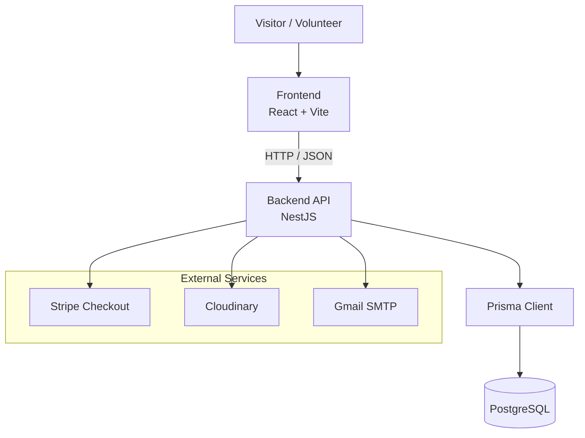

# VAF Project Overview

> **Vinit Abhedya Foundation (VAF)**
>
> A public website and volunteer management platform for environmental
> and community initiatives, including Sambhajinagar Ploggers.

---

## Table of Contents

1. [Purpose](#purpose)
2. [Project Structure](#project-structure)
3. [User-Facing Pages](#user-facing-pages)
4. [Implemented Capabilities](#implemented-capabilities)
5. [Frontend-to-Backend Communication](#frontend-to-backend-communication)
6. [Repository Limitations and Observations](#repository-limitations-and-observations)
7. [Documentation Map](#documentation-map)

---

## Purpose

The Vinit Abhedya Foundation (VAF) project is a public website and volunteer
management system for the foundation's environmental and community initiatives.
It combines a public-facing React website with a REST API and a volunteer
and administrator portal.

The public website presents the foundation, its initiatives, impact information,
stories, media, and ways to participate or donate. The portal supports volunteer
accounts, plogging-drive participation, attendance management, administrative
operations, and certificates.

## Project Structure

| Component | Location | Responsibility |
|---|---|---|
| Frontend | [`VAF_frontend/`](../VAF_frontend/) | React single-page website and role-aware portal |
| Backend | [`VAF_backend/ploggers-attendance-system/`](../VAF_backend/ploggers-attendance-system/) | NestJS REST API, authentication, business logic, and Prisma data access |
| Database | PostgreSQL configured through Prisma | Persistent application data, including users, drives, participations, certificates, messages, notifications, and newsletter subscribers |
| Deployment configuration | [`VAF_frontend/vercel.json`](../VAF_frontend/vercel.json) | Frontend Vercel build/output, SPA routes, and response headers |

This is a two-application workspace rather than a single shared package or
package-managed monorepo. Each application has its own `package.json` and
lock file.

## User-Facing Pages

The frontend registers the following routes in
[`App.tsx`](../VAF_frontend/src/App.tsx).

| Surface | Routes |
|---|---|
| Public foundation pages | `/`, `/privacy-policy`, `/ploggers`, `/social-shelf`, `/laal-bindi`, `/gallery`, `/newsletter-success`, `/donate` |
| Blog | `/blog`, `/blog/:slug` |
| Account access | `/login`, `/signup` |
| Portal | `/dashboard`, `/admin-dashboard`, `/superadmin-dashboard` |
| Fallback | `*` renders the not-found page |

The public home page assembles sections for impact, about, initiatives, media,
testimonials, volunteer of the month, donations, FAQs, and the footer.

The blog and initiative pages are frontend routes. The backend controllers
do not provide a blog-content API.

## Implemented Capabilities

- **Public website:** Foundation information and initiative pages for Ploggers,
  Social Shelf, and Laal Bindi.
- **Volunteer accounts:** Registration, login, profile access and updates,
  and role-based portal routes.
- **Drive management:** Drive creation and browsing, volunteer participation,
  and attendance submission and approval, including an administrator QR scan
  operation.
- **Administration:** User and volunteer management, dashboards, leaderboard
  data, administrator broadcasts, and notifications.
- **Certificates:** Certificate generation for approved participants of
  completed drives, certificate template upload and management, and volunteer
  certificate retrieval.
- **Newsletter:** Public subscription with confirmation email behavior.
- **Donations:** Stripe checkout-session creation. This integration alone does
  not establish a complete payment reconciliation or receipt workflow.

## Frontend-to-Backend Communication

The frontend uses a shared Axios client alongside some direct `fetch` calls.

The shared Axios client uses `VITE_API_URL` when configured and otherwise
defaults to `http://localhost:3000/api`. The backend applies the global
`/api` prefix.

Authenticated Axios requests use a bearer token stored in browser
`localStorage`. Dashboard hooks also communicate with the API directly
through `fetch`.

### Architecture Diagram

The diagram below illustrates the main application components and external
integrations.

**Diagram notes**

- The frontend communicates with the backend through HTTP requests.
- The backend uses Prisma to access PostgreSQL.
- Stripe, Cloudinary, and Gmail SMTP are shown as external integrations.
- This is a high-level logical diagram, not a deployment or network topology.

For more detailed architecture and sequence diagrams, see
[`04-SYSTEM-ARCHITECTURE.MD`](./04-SYSTEM-ARCHITECTURE.MD).

## Repository Limitations and Observations

The following observations describe what was found in the active repository.
They should not be interpreted as claims about external systems or production
operations.

- **Infrastructure:** No backend container, Kubernetes, or infrastructure-as-code
  configuration was found in the active backend project directory.
- **Backend deployment:** No backend hosting or deployment manifest was found.
  The frontend has Vercel configuration, but that alone does not establish
  where the backend is hosted.
- **Authentication routes:** No password-reset, refresh-token, or logout API
  route is registered.
- **Stripe return routes:** The code redirects successful and cancelled
  checkout sessions to `/payment-success` and `/payment-cancel`. These paths
  are not registered in the frontend router or the listed Vercel SPA rewrites.

## Documentation Map

Use the following documents to explore the project in more detail.

| # | Document | Description |
|---|---|---|
| 1 | [Project Overview](./01-PROJECT-OVERVIEW.MD) | Project purpose, structure, and capabilities |
| 2 | [Product Idea and Requirements](./02-PRODUCT-IDEA-AND-REQUIREMENTS.MD) | Product goals and requirements |
| 3 | [Tech Stack](./03-TECH-STACK.MD) | Technologies and dependencies |
| 4 | [System Architecture](./04-SYSTEM-ARCHITECTURE.MD) | Components and application flows |
| 5 | [Setup and Development Guide](./05-SETUP-AND-DEVELOPMENT-GUIDE.MD) | Local setup and development |
| 6 | [Database and API Guide](./06-DATABASE-AND-API-GUIDE.MD) | Data models and API endpoints |
| 7 | [Authentication and Security](./07-AUTHENTICATION-AND-SECURITY.MD) | Authentication and security details |
| 8 | [Deployment and Maintenance](./08-DEPLOYMENT-AND-MAINTENANCE.MD) | Deployment and maintenance notes |

---

*VAF Project Documentation · Project Overview*
