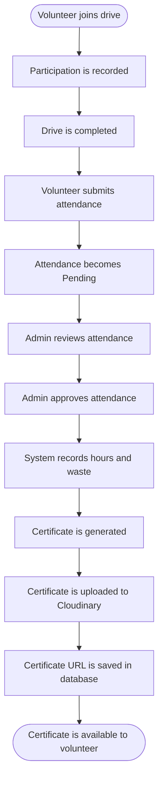

# Product Idea and Source-Derived Requirements

> **Document 02 · Product Specification**
>
> A source-derived baseline of VAF's implemented product behavior, user roles, operational workflows, and known limitations.

---

## Table of Contents

1. [Product Idea](#product-idea)
2. [Implemented Product Surface](#implemented-product-surface)
3. [Source-Derived Behavioral Requirements](#source-derived-behavioral-requirements)
4. [Roles and Intended Operators](#roles-and-intended-operators)
5. [Implemented vs. Proposed or Unverified](#implemented-vs-proposed-or-unverified)
6. [Workflow: Volunteer Attendance to Certificate](#workflow-volunteer-attendance-to-certificate)

---

## Product Idea

VAF's website communicates the foundation's environmental and community work. It enables visitors to discover initiatives, volunteer, receive updates, and donate.

Its portal provides operational tools for managing volunteers and plogging drives and recording verified participation.

The requirements in this document describe behavior evidenced by the current frontend, backend, data transfer objects (DTOs), and Prisma schema. They form a source-derived baseline and are not a replacement for a separately approved product specification.

## Implemented Product Surface

| Area | Implemented behavior evidenced in source |
|---|---|
| Public information | Home page sections for impact, foundation information, initiatives, media, testimonials, volunteer of the month, donations, FAQs, and contact/footer content. |
| Initiative discovery | Separate `/ploggers`, `/social-shelf`, and `/laal-bindi` pages, plus `/gallery`. |
| Stories | `/blog` and `/blog/:slug` frontend routes; no backend blog API is registered. |
| Volunteer registration | Signup submits volunteer profile fields. The API creates a `User` with `Pending` status and returns a generated Plogger ID. |
| Account access | User login and administrator login APIs issue signed JWTs. Approved accounts are required for login. |
| Volunteer portal | User dashboard route and API data for profile/dashboard, attendance, upcoming drives, and certificates. |
| Drive operations | Public drive/location browsing; Admin and SuperAdmin drive/location creation, update, and completion operations. |
| Participation and attendance | Join a drive, request attendance after completion, admin QR scanning of a participation, and individual or bulk approval. |
| Administration | Volunteer listing, search, approval, suspension, deletion, promotion, dashboard statistics, attendance review, and broadcast messaging. |
| Certificates | Generate certificates for approved participation in a completed drive, upload/manage templates, and list a volunteer's certificates. |
| Newsletter | Public email subscription, reactivation of inactive subscriptions, and best-effort confirmation email. |
| Donations | Frontend amount entry calls the authenticated checkout endpoint; the backend creates a Stripe Checkout session in INR. |

### Important Donation Distinction

The standalone `/donate` page also describes cloth donations and contains a separate hard-coded external Stripe link. That link does not call the backend's session-creation route.

The home page's API-driven donation action calls an endpoint that requires a bearer token. These are separate paths and should not be described as one complete public donation workflow.

## Source-Derived Behavioral Requirements

The following statements summarize behavior implemented in the inspected source and provide a baseline for future changes.

1. **Volunteer registration:** Registration creates a volunteer account in `Pending` status. Only an approved account can log in.

2. **Unique Plogger ID:** Each registered volunteer receives a unique Plogger ID derived from the account ID and gender code.

3. **Drive participation:** A volunteer can join a drive only once and cannot join a completed drive.

4. **Attendance submission:** A volunteer can submit an attendance request only for a joined drive after it is completed. The request transitions to pending review.

5. **Attendance review:** Admins and SuperAdmins can review attendance. The QR scan path marks an eligible registered participation as approved immediately. Manual approval records hours and waste.

6. **Bulk approval:** Bulk attendance approval is transactional and sets hours from the drive's configured total hours.

7. **Certificate generation:** Certificate generation requires a completed drive and selects approved participants. A unique user/drive certificate prevents duplicates.

8. **Newsletter subscriptions:** Newsletter addresses are normalized to lowercase. An already-active subscription conflicts; an inactive row is reactivated.

9. **Donation validation:** The API validates donation amounts within the INR 1–100,000 range, allowing no more than two decimal places, before creating a Stripe Checkout session.

The data models and API contracts behind these requirements are documented in [06-DATABASE-AND-API-GUIDE.MD](./06-DATABASE-AND-API-GUIDE.MD).

## Roles and Intended Operators

| Role | Source-backed scope |
|---|---|
| Visitor | Browse public pages and submit a newsletter subscription. |
| User (volunteer) | Register, log in when approved, view/update supported profile data, join drives, submit attendance, and view certificates. |
| Admin | Manage many volunteer, drive, attendance, dashboard, and broadcast operations. |
| SuperAdmin | Admin operations plus privileged user/admin management, such as creating admins and promoting or deleting users. |

Authorization is endpoint-specific. Exact route guards and permitted role sets are documented in the API guide and [07-AUTHENTICATION-AND-SECURITY.MD](./07-AUTHENTICATION-AND-SECURITY.MD).

## Implemented vs. Proposed or Unverified

| Status | Item | Evidence or boundary |
|---|---|---|
| Implemented | User registration, admin portal routes, blog routes, and Stripe checkout-session creation. | Present in frontend routing/components and backend modules. |
| Partially implemented | Donation journey. | Checkout-session creation exists but requires a bearer token. The standalone donate page uses a separate hard-coded external Stripe link. The frontend router does not register the backend's success/cancel redirect paths. No payment webhook or donation record model is present in the inspected backend. |
| Not evidenced | CMS/editor for website or blog content. | No CMS module or content-management API/model is registered. |
| Not evidenced | Password reset, email verification, refresh-token, or logout flow. | No corresponding route or workflow was found in the inspected auth controller. |
| Not evidenced | Payment webhook/reconciliation, donation receipts, or persisted donation ledger. | No such route/model is present in the inspected controllers/schema. |
| Proposed in the frontend README, but not proof of a current gap | CMS/admin content editing, volunteer signup forms, blog/updates, donation integration, and SEO. | The README's future-enhancement list is older or broader than the code: signup, blog routes, donation checkout, SEO metadata, and admin functionality already exist in some form. It does not establish completed editorial or operational workflows. |

The "not evidenced" entries identify boundaries for further product decisions. They do not establish that a feature is absent from every external system.

## Workflow: Volunteer Attendance to Certificate

This flow summarizes the manual attendance-review process.

### Workflow Notes

- Attendance submission is available after a joined drive has been completed.
- Manual approval records hours and waste.
- Certificate generation selects approved participants of completed drives.
- Certificate files are uploaded to Cloudinary, and their URLs are persisted.
- A unique user/drive certificate prevents duplicate certificates.
- The QR attendance scan is a separate path: it can immediately approve an eligible registered participation rather than following the manual pending-review sequence.

---

*VAF Project Documentation · Product Idea and Source-Derived Requirements*
