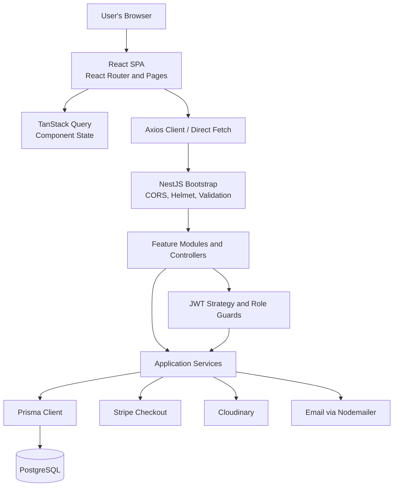
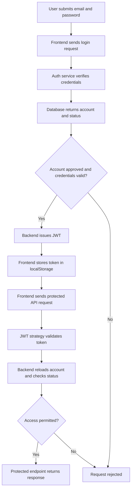
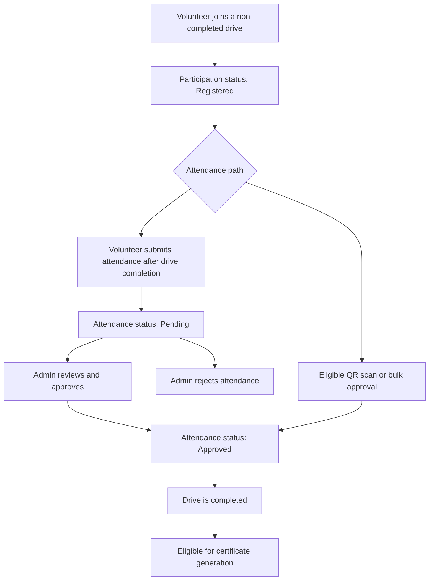

# System Architecture

## 1. Runtime Architecture

VAF 2.0 consists of a React frontend, a NestJS backend, a PostgreSQL database, and external services for payments, file storage, and email delivery.

### Frontend

The frontend is a Vite-built single-page application (SPA).

- `src/main.tsx` mounts `App` inside `BrowserRouter`.
- `App.tsx` defines the route map, lazy-loaded page imports, React Query provider, and client-side portal guards.
- TanStack Query and local component state manage frontend data and UI state.
- API requests use the shared Axios client or direct `fetch` calls.
- The API base URL comes from `VITE_API_URL`, falling back to `http://localhost:3000/api`.

### Frontend Hosting

Vercel serves the built frontend from the Vite `dist` output. The frontend deployment configuration is described in [08-DEPLOYMENT-AND-MAINTENANCE.MD](./08-DEPLOYMENT-AND-MAINTENANCE.MD).

### Backend

The backend is built with NestJS.

- `src/main.ts` creates the Nest application and enables shutdown hooks.
- Bootstrap configures the CORS origin allowlist, Helmet, global validation, and the `/api` prefix.
- Swagger is optionally exposed outside production.
- `AppModule` registers the feature modules.
- Controllers handle HTTP requests, services implement application operations, and Prisma provides database access through `DatabaseService`.

The backend does not use identical internal wiring for every endpoint. The module descriptions below represent the dominant organization of the source code.

## 2. Backend Module and Layer Map

| Module | Primary responsibilities |
|---|---|
| `auth` | Registration, login, JWT generation, profile updates, and admin account operations. |
| `user` | Volunteer profiles, user administration, and user-level attendance. |
| `drive` | Drive and location create/read/update operations and drive completion. |
| `attendance` | Drive participation, attendance marking, QR scanning, and approval. |
| `dashboard` and `admin` | User dashboard data and administrator statistics. |
| `certificate` | Certificate creation, retrieval, and template management. |
| `payment` | Stripe Checkout session creation. |
| `newsletter` | Newsletter subscription and reactivation. |
| `message` and `mail` | Broadcasts, notifications, and email delivery. |
| `cloudinary` | Certificate and template file operations and connectivity checks. |
| `database` | Prisma Client lifecycle and PostgreSQL connection. |
| `common` | Guards, request decorators, and exception filter implementation. |

## 3. API Communication Contract

- **API prefix:** `/api`.
- **Payloads:** JSON, except certificate-template uploads, which use multipart form-data with a `file` field and optional `name`.
- **Authentication:** Protected endpoints accept a JWT in the `Authorization` header.
- **Axios timeout:** The shared Axios client uses a 10-second timeout.
- **Unauthorized responses:** A `401` response handled by the shared Axios interceptor clears `token`, `role`, and `user` from local storage and redirects to `/login`.
- **Direct requests:** Some dashboard operations use `fetch` rather than the shared Axios client.
- **Validation:** The global NestJS validation pipe transforms DTO inputs and enables `whitelist` and `forbidNonWhitelisted`, rejecting unknown properties.

The complete endpoint inventory, access rules, and request DTO mapping are documented in [06-DATABASE-AND-API-GUIDE.MD](./06-DATABASE-AND-API-GUIDE.MD).

## 4. Authentication and Authorization Flow

For the complete authentication model, token lifecycle, role enforcement, and security controls, see [07-AUTHENTICATION-AND-SECURITY.MD](./07-AUTHENTICATION-AND-SECURITY.MD).

## 5. Business Workflow: Drive Participation

The following diagram summarizes the main participation and attendance states. Individual QR, manual approval, and bulk approval paths have different rules.

Important behavior from the inspected implementation:

- Volunteers cannot join a drive that is already completed.
- The QR scan path rejects completed drives, attendance that has already been marked, and participations not in `Registered` status.
- Volunteers can submit attendance after drive completion; the record enters `Pending` for review.
- Manual approval records hours and waste. Bulk approval has different input and transition behavior.
- Certificate eligibility depends on the completed drive and approved participation.

For exact route behavior and request fields, consult the attendance and certificate sections in [06-DATABASE-AND-API-GUIDE.MD](./06-DATABASE-AND-API-GUIDE.MD).

## 6. External Services

| Integration | Source-backed use |
|---|---|
| PostgreSQL | Primary persistence through Prisma. |
| Stripe | Creates one-time INR Checkout sessions. |
| Cloudinary | Stores certificate files and certificate templates. |
| Gmail SMTP | Sends confirmation and broadcast emails through Nodemailer. |

## 7. Deployment Scope

The repository does not contain a backend deployment manifest in the inspected source. The frontend uses Vercel configuration for deployment.

See [08-DEPLOYMENT-AND-MAINTENANCE.MD](./08-DEPLOYMENT-AND-MAINTENANCE.MD) for frontend deployment settings, response headers, environment variables, and hosting details.
