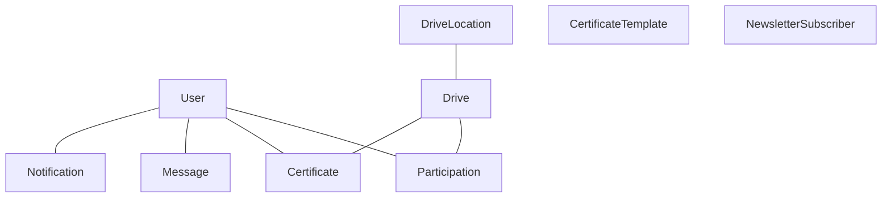
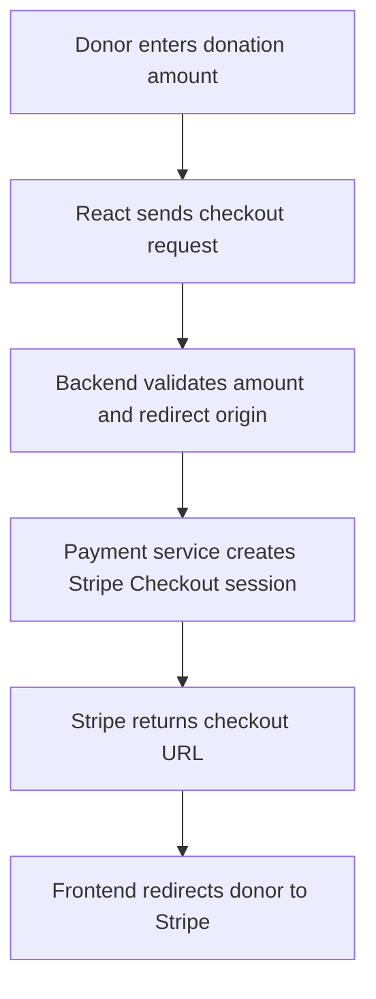

# Database and API Guide

## 1. Database Overview

The backend uses Prisma Client with a PostgreSQL datasource. The Prisma schema is defined in [`prisma/schema.prisma`](../VAF_backend/ploggers-attendance-system/prisma/schema.prisma).

All timestamps are represented as Prisma `DateTime` fields. A `?` after a field type indicates that the field is nullable.

## 2. Database Models

| Model | Fields and constraints |
|---|---|
| `User` | `id` (auto-increment primary key), `name`, unique `email`, `password`, optional `phone`, `parentNumber`, `bloodGroup`, `birthDate`, `gender`, `occupation`, `highestQualification`, `address`, `city`, `state`, `collegeOrCompany`; `role` defaults to `User`; `drivesCount` defaults to `0`; unique `ploggerId`; `createdAt` defaults to now; `updatedAt` is automatically updated; `status` defaults to `Pending`. |
| `Drive` | `id` primary key, `date`, `totalHours`, `totalWasteKg` defaults to `0`, `volunteerCount` defaults to `0`, unique `temporaryToken`, optional `expiryDate`, `locationId` foreign key, timestamps, optional `title`, `certificateIssued` defaults to `false`, `completed` defaults to `false`. |
| `DriveLocation` | `id` primary key, unique `location`, timestamps. |
| `Participation` | `id` primary key, `userId` and `driveId` foreign keys, `hours` and `waste` default to `0`, `createdAt`, `status` defaults to `Registered`, `attendanceMarked` defaults to `false`; unique combination of `userId` and `driveId`. |
| `Message` | `id` primary key, `subject`, `content`, `senderId` foreign key, `recipients` defaults to `0`, `isBroadcast` defaults to `true`, `createdAt`. |
| `Notification` | `id` primary key, optional `userId` foreign key, `title`, `message`, `isRead` defaults to `false`, `createdAt`. |
| `Certificate` | `id` primary key, `userId` and `driveId` foreign keys, optional `fileUrl`, `issuedAt` defaults to now; unique combination of `userId` and `driveId`. |
| `CertificateTemplate` | `id` primary key, `name`, `fileUrl`, `publicId`, `createdAt`, `updatedAt`. |
| `NewsletterSubscriber` | `id` primary key, unique `email`, `createdAt`, `isActive` defaults to `true`. |

### Indexes and Unique Constraints

The Prisma schema defines indexes for:

- `User.email`
- `Drive.locationId` and `Drive.temporaryToken`
- `Participation.userId`, `Participation.driveId`, and `Participation.status`
- `Message.senderId`
- `Certificate.userId` and `Certificate.driveId`
- `CertificateTemplate.name`
- `NewsletterSubscriber.email`

Unique constraints are declared for user email, Plogger ID, drive token, drive location, the user/drive participation pair, the user/drive certificate pair, and subscriber email.

## 3. Database Enums

| Enum | Values |
|---|---|
| `Gender` | `Male`, `Female`, `Other` |
| `Occupation` | `Student`, `WorkingProfessional`, `Other` |
| `BloodGroup` | `A_POSITIVE`, `A_NEGATIVE`, `B_POSITIVE`, `B_NEGATIVE`, `AB_POSITIVE`, `AB_NEGATIVE`, `O_POSITIVE`, `O_NEGATIVE` |
| `Role` | `User`, `Admin`, `SuperAdmin` |
| `UserStatus` | `Pending`, `Approved`, `Suspended` |
| `AttendanceStatus` | `Pending`, `Approved`, `Rejected`, `Registered` |

## 4. Database Relationships

`Participation` is the explicit many-to-many join between `User` and `Drive`.

`CertificateTemplate` and `NewsletterSubscriber` have no Prisma relations to other models. `Notification.userId` is optional.

The schema does not declare an explicit relation from a message to each recipient. Broadcast messages record a recipient count and create individual `Notification` records.

## 5. Transaction Boundaries and Persistence

- Volunteer registration creates the user and finalizes the Plogger ID inside a Prisma `$transaction`.
- Bulk attendance approval uses a Prisma `$transaction` to transition the selected records.
- Certificate file upload and database creation are separate operations. If database persistence fails, the certificate service attempts to delete the uploaded file.
- Newsletter subscription is persisted before a confirmation email is attempted. Email delivery is best-effort and does not undo the subscription.
- Message broadcasting sends bulk email before persisting the `Message` and creating notifications.

## 6. Migration History and Caution

Three migration SQL files are present:

1. `20260415211602_init`
2. `20260421202858_add_participation`
3. `20260908143500_add_certificate_templates`

The initial migration contains an older schema shape, including a `_DriveUsers` join table. The current Prisma schema uses `Participation` and includes additional models, fields, and enum values that are not represented across all three migration files.

**Before deploying migrations, compare the migration history and the actual database schema against the current Prisma schema.**

The `migrate:deploy` script applies migration files; it does not automatically reconcile missing schema changes.

## 7. API Conventions

- **Base prefix:** `/api`
- **Content type:** JSON, except multipart certificate-template uploads.
- **Validation:** NestJS `ValidationPipe` transforms DTOs, rejects unknown properties, and validates DTO fields.
- **Pagination:** Drive and location listing endpoints use `page` and `limit`. The drive service validates positive integers and caps page size at 50.
- **Route parameters:** `:id` parameters are integers; some user IDs are additionally checked as positive integers.

## 8. DTO Request Fields and Constraints

The following tables summarize DTO fields and source-declared validation constraints. Optional fields may be omitted.

| DTO | Fields and constraints |
|---|---|
| `CreateUserDto` | Required: `name`, `email`, `password`, `phone`, `bloodGroup`, `birthDate`, `gender`, `highestQualification`, `occupation`, `address`, `parentNumber`. Optional: `city`, `state`, `collegeOrCompany`. Email max 255 characters; phone must match a 10-digit Indian mobile pattern; password 8–50 characters, requiring at least one letter and one number. |
| `LoginUserDto` | `email`, `password`; password length 6–50. |
| `LoginAdminDto` | `email`, `password`; password length 8–50. |
| `CreateAdminDto` | `name`, `email`, `city`, `gender`, `password`; password 8–50 characters, requiring a letter and a number. |
| `UpdateUserDto` | Optional: `name`, `phone`, `bloodGroup`, `birthDate`, `highestQualification`, `occupation`, `address`, `parentNumber`, `city`, `state`, `collegeOrCompany`. Does not expose role, status, email, or password. |
| `UpdateProfileDto` | Optional: `name`, `birthDate`, `gender`, `bloodGroup`, `phone`, `parentNumber`, `address`, `city`, `state`, `occupation`, `highestQualification`, `collegeOrCompany`. |
| `CreateDriveDto` | `title`, `location`, `date`, `totalHours`; title and location are strings, date is transformed to `Date`, and hours to a positive integer. |
| `UpdateDriveDto` | Partial `CreateDriveDto`. |
| `CreateDriveLocationDto` | `location` string, max 255 characters. |
| `CompleteDriveDto` | `totalWasteKg`, a non-negative integer. |
| `JoinDriveDto` | Positive integer `driveId`. |
| Attendance `MarkAttendanceDto` | Positive integer `driveId` for the attendance API. The user-service attendance flow also uses a `temporaryToken` of 5–100 characters, allowing letters, digits, underscores, and hyphens. |
| `ScanAttendanceDto` | Positive integer `participationId`, transformed from input to a number. |
| `ApproveAttendanceDto` | Positive integer `hours` and non-negative integer `waste`. |
| `BulkApproveAttendanceDto` | Non-empty array of unique positive integer `participationIds`. |
| `CreateMessageDto` | Non-empty `subject` (max 150 characters) and `content` (max 5,000 characters). |
| `SubscribeNewsletterDto` | Valid, non-empty `email`, max 255 characters; normalized to lowercase. |
| `CreatePaymentDto` | Positive numeric `amount` in INR, from 1 to 100,000, with up to two decimal places. |

`POST /api/user/create-volunteer` and `PATCH /api/user/attendance/approve/:id` use inline TypeScript body types rather than DTO classes. Their documented fields are based on the source-declared types and do not imply equivalent `class-validator` metadata.

## 9. Authentication and Access Control

Role names in the API tables refer to the backend's `Role` enum.

- **Public:** No authentication required by the route's access configuration.
- **Authenticated:** Requires a valid JWT in the `Authorization` header.
- **User:** Volunteer role.
- **Admin:** Admin or SuperAdmin where the route's guard allows both roles.
- **SuperAdmin:** SuperAdmin role only.

The exact token and account-status checks are documented in [07-AUTHENTICATION-AND-SECURITY.MD](./07-AUTHENTICATION-AND-SECURITY.MD).

## 10. Authentication API

| Method and route | Access | Request / behavior |
|---|---|---|
| `POST /api/auth/register` | Public | `CreateUserDto`; creates a pending volunteer account. |
| `POST /api/auth/login` | Public | `LoginUserDto`; returns user JWT and user/role data. |
| `GET /api/auth/me` | Authenticated | Returns the current authenticated user. |
| `PATCH /api/auth/update-user` | Authenticated | `UpdateUserDto`; updates supported profile fields. |
| `PATCH /api/auth/update-user/:id` | Admin only | `UpdateUserDto`; updates another user by database ID. |
| `POST /api/auth/adminlogin` | Public | `LoginAdminDto`; authenticates Admin or SuperAdmin accounts. |
| `POST /api/auth/adminregister` | SuperAdmin | `CreateAdminDto`; creates an Admin account. |
| `GET /api/auth/users` | Admin only | Lists users with selected identity and role fields. |

## 11. User API

| Method and route | Access | Request / behavior |
|---|---|---|
| `GET /api/user/details` | User, Admin, SuperAdmin | Current authenticated user's details. |
| `PATCH /api/user/profile` | User | `UpdateProfileDto`; updates volunteer profile. |
| `GET /api/user/details/:ploggerId` | Admin, SuperAdmin | Finds a user by Plogger ID. |
| `GET /api/user/all` | Admin, SuperAdmin | Lists all users. |
| `GET /api/user/leaderboard` | Admin, SuperAdmin | Contributor leaderboard. |
| `GET /api/user/search?q=...` | Admin, SuperAdmin | Searches users using query parameter `q`. |
| `PATCH /api/user/approve/:id` | Admin, SuperAdmin | Approves a user. |
| `PATCH /api/user/suspend/:id` | Admin, SuperAdmin | Suspends a user. |
| `POST /api/user/create-volunteer` | SuperAdmin | Inline body: `name`, `email`, `gender`, `password`; optional `city`. |
| `DELETE /api/user/:id` | SuperAdmin | Deletes a user. |
| `PATCH /api/user/promote/:id` | SuperAdmin | Promotes a user to Admin. |
| `POST /api/user/attendance` | User | `MarkAttendanceDto` containing a drive `temporaryToken`. |
| `GET /api/user/attendance/pending` | Admin, SuperAdmin | Lists pending attendance. |
| `PATCH /api/user/attendance/approve/:id` | Admin, SuperAdmin | Optional JSON fields `hours` and `waste`. |
| `PATCH /api/user/attendance/reject/:id` | Admin, SuperAdmin | Rejects attendance. |
| `GET /api/user/drivesattended` | User | Returns drives attended by the current volunteer. |

## 12. Drive API

| Method and route | Access | Request / behavior |
|---|---|---|
| `POST /api/drive/newdrive` | Admin, SuperAdmin | `CreateDriveDto`: `title`, `location`, `date`, `totalHours`. |
| `POST /api/drive/newlocation` | Admin, SuperAdmin | `CreateDriveLocationDto`: `location`. |
| `PATCH /api/drive/:id` | Admin, SuperAdmin | Partial `CreateDriveDto` through `UpdateDriveDto`. |
| `GET /api/drive/alldrives?page=1&limit=10` | Public | Paginated drive list. |
| `GET /api/drive/alllocations?page=1&limit=10` | Public | Paginated location list. |
| `GET /api/drive/upcoming` | Public | Upcoming, incomplete drives. |
| `GET /api/drive/date/:date` | Public | Drives matching the specified date. |
| `GET /api/drive/:id` | Public | Drive by numeric ID. |
| `PATCH /api/drive/:id/complete` | Admin, SuperAdmin | `CompleteDriveDto`: non-negative integer `totalWasteKg`. |

## 13. Attendance API

Every route in this group requires a bearer JWT. Routes labeled Admin require Admin or SuperAdmin access.

| Method and route | Access | Request / behavior |
|---|---|---|
| `GET /api/attendance/all` | Admin | Lists all participation records. |
| `POST /api/attendance/join` | Authenticated | `JoinDriveDto`: positive integer `driveId`. |
| `POST /api/attendance/mark` | Authenticated | `MarkAttendanceDto`: positive integer `driveId`; submits attendance after drive completion. |
| `POST /api/attendance/scan` | Admin | `ScanAttendanceDto`: `participationId`; scans or marks attendance. |
| `PATCH /api/attendance/approve/:id` | Admin | `ApproveAttendanceDto`: positive `hours`, non-negative `waste`. |
| `PATCH /api/attendance/approve-bulk` | Admin | `BulkApproveAttendanceDto`: non-empty array of unique `participationIds`. |
| `GET /api/attendance/my` | Authenticated | Returns the current user's attendance. |

The similarly named `/api/user/attendance...` routes are separate user-service operations. Both route groups are currently registered.

## 14. Other APIs

| Method and route | Access | Request / behavior |
|---|---|---|
| `GET /api/dashboard/me` | Authenticated | Current user's dashboard data. |
| `GET /api/admin/dashboard-stats` | Admin, SuperAdmin | Volunteer, drive, hour, and waste statistics; chart data and leaderboard. |
| `GET /api/message/all` | Admin, SuperAdmin | Broadcast message history. |
| `POST /api/message/send` | Admin, SuperAdmin | `CreateMessageDto`: `subject`, `content`; sends a broadcast. |
| `GET /api/message/notifications` | Authenticated | Current user's notification records. |
| `POST /api/payment/checkout` | Authenticated | `CreatePaymentDto`: INR amount from 1 to 100,000, up to two decimal places. |
| `POST /api/certificate/generate/:driveId` | Admin, SuperAdmin | Generates certificates for eligible participants of a completed drive. |
| `GET /api/certificate/my-certificates` | Authenticated | Returns the current user's certificates. |
| `POST /api/certificate/templates` | Admin, SuperAdmin | Multipart `file` upload; PNG/JPEG, max 5 MiB; optional form field `name`. |
| `GET /api/certificate/templates` | Admin, SuperAdmin | Lists certificate templates. |
| `DELETE /api/certificate/templates/:id` | Admin, SuperAdmin | Deletes a template. |
| `GET /api/cloudinary/ping` | Authenticated | Checks Cloudinary connectivity. |
| `POST /api/newsletter/subscribe` | Public | `SubscribeNewsletterDto`: `email`; explicit response status 200. |

## 15. Donation Checkout Flow

The checkout endpoint is `POST /api/payment/checkout` and requires a bearer JWT.

The backend configures Stripe redirects to `/payment-success` and `/payment-cancel`. Frontend route handling for these paths is not registered in the inspected source.

## 16. API Documentation

NestJS Swagger is configured in `src/main.ts` for non-production execution and uses bearer-authentication metadata.

- **Global API prefix:** `/api`
- **Swagger UI path:** `/swagger`
- **Production behavior:** Swagger is only installed when `NODE_ENV` is not `production`.

## 17. Related References

- [System Architecture](./04-SYSTEM-ARCHITECTURE.MD)
- [Setup and Development Guide](./05-SETUP-AND-DEVELOPMENT-GUIDE.MD)
- [Authentication and Security](./07-AUTHENTICATION-AND-SECURITY.MD)
- [Deployment and Maintenance](./08-DEPLOYMENT-AND-MAINTENANCE.MD)
