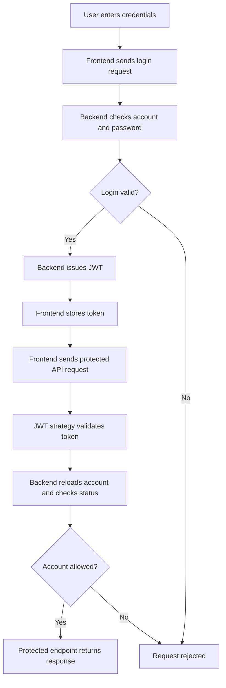

# Authentication and Security

## 1. Authentication Model

The backend uses JWT (JSON Web Token) bearer authentication through Passport's JWT strategy.

The frontend stores the returned token in `localStorage` under `token` and sends it in the `Authorization` header for protected requests. The inspected authentication code does not configure cookie-based sessions.

## 2. Login and Token Lifecycle

| Account flow | Behavior |
|---|---|
| Volunteer registration | Creates a `User` with role `User` and status `Pending`; generates a unique Plogger ID within a transaction. |
| User login | Requires an approved account and issues a JWT with a two-hour expiry. |
| Admin login | Looks for `Admin` or `SuperAdmin` accounts, requires approved status, and issues a JWT with a six-hour expiry. |
| Request authentication | The strategy validates the token signature and expiry, reloads the account by ID, and rejects missing, Pending, or Suspended accounts. |
| Browser `401` handling | The shared Axios interceptor removes `token`, `role`, and `user` from local storage, then redirects to `/login`. Direct `fetch` calls do not use this interceptor. |

The JWT payload contains the subject (`sub`), email, and role. The strategy uses current database values for role and status rather than relying only on client-side state.

## 3. Authentication Flow

### Login Endpoints

| Endpoint | Purpose |
|---|---|
| `/api/auth/login` | User login |
| `/api/auth/adminlogin` | Admin and SuperAdmin login |

## 4. Authorization

The persisted role enum contains `User`, `Admin`, and `SuperAdmin`.

- The backend combines the JWT guard with role metadata and `RolesGuard` on role-restricted routes.
- Some controllers, including certificate routes, perform explicit role checks themselves.
- Client-side route guards in `App.tsx` control navigation to user, admin, and SuperAdmin dashboard pages.
- Frontend route guards improve navigation but do not replace backend authorization checks.

For the complete per-route role matrix, see [06-DATABASE-AND-API-GUIDE.MD](./06-DATABASE-AND-API-GUIDE.MD).

## 5. Password Handling

- Passwords are hashed with `bcrypt.hash` using 12 rounds before user or admin persistence.
- Login uses `bcrypt.compare` to verify passwords.
- When an email is not found, a dummy bcrypt hash is compared to reduce timing differences between unknown-account and incorrect-password cases.
- User and admin login DTOs constrain password string lengths.
- Signup and admin creation require a minimum password length and a letter-plus-number pattern.
- General profile update DTOs do not expose password changes.
- No password change or reset endpoint is registered in the authentication controller.

## 6. Request Validation and HTTP Protections

The backend bootstrap configures the following protections:

- **Global DTO validation:** Enables transformation, `whitelist: true`, and `forbidNonWhitelisted: true`.
- **Helmet:** Adds HTTP security headers.
- **CORS:** Enables credentials and uses an explicit allowed-origin list:
  - `http://localhost:8080`
  - `http://localhost:5173`
  - `https://vaf-frontend.vercel.app`
  - `https://vinitabhedyafoundation.com`
  - `https://www.vinitabhedyafoundation.com`
- **Origin handling:** Requests without an `Origin` header are permitted by the CORS callback. Origins outside the allowlist are not granted CORS access.
- **Rate limiting:** A global Nest throttler guard is configured for 100 requests per 60 seconds.
- **API prefix:** Backend endpoints use the `/api` prefix.
- **Swagger:** Installed only when `NODE_ENV` is not `production`.

The frontend Vercel configuration also declares response headers, including `X-Content-Type-Options`, `X-Frame-Options`, `Referrer-Policy`, `Permissions-Policy`, and a Content Security Policy (CSP). The CSP's `connect-src` currently names the production backend origin in the Vercel configuration.

## 7. Secret and Environment Handling

The backend uses these environment variables:

| Variable | Purpose |
|---|---|
| `DATABASE_URL` | Database connection |
| `JWT_SECRET_KEY` | JWT signing and verification |
| `STRIPE_SECRET_KEY` | Stripe payment integration |
| `CLOUDINARY_CLOUD_NAME` | Cloudinary account configuration |
| `CLOUDINARY_API_KEY` | Cloudinary API authentication |
| `CLOUDINARY_API_SECRET` | Cloudinary API authentication |
| `EMAIL_USER` | Email account configuration |
| `EMAIL_PASS` | Email account credentials |
| `FRONTEND_URL` | Payment redirect configuration |

The frontend uses `VITE_API_URL` to configure the API base URL. This is public frontend configuration and must not contain secrets.

`JWT_SECRET_KEY` must be at least 32 characters after leading and trailing whitespace is trimmed, as enforced by the authentication service and strategy.

Store credentials in private environment configuration or a secret manager. Rotate them through the hosting environment. Never commit or copy secret values into documentation, browser variables, logs, or screenshots.

Local `.env` files exist in the workspace. Their contents are deliberately excluded from this documentation.

## 8. Browser Token Storage and Session Scope

The implemented frontend stores JWTs in `localStorage`, which is accessible to JavaScript running on the page. Protect the application against cross-site scripting (XSS) and other script-injection risks. Having a CSP does not replace reviewing scripts and content sources.

The registered authentication controller does not provide refresh-token, logout, or server-side session endpoints.

The shared Axios client removes local authentication values when it receives a `401` response. Direct `fetch` calls have their own response handling and do not automatically use the shared Axios interceptor.

## 9. Related References

- [Database and API Guide](./06-DATABASE-AND-API-GUIDE.MD) — API access matrix and role restrictions.
- [Setup and Development Guide](./05-SETUP-AND-DEVELOPMENT-GUIDE.MD) — setup instructions and environment-variable names.
- [Deployment and Maintenance](./08-DEPLOYMENT-AND-MAINTENANCE.MD) — deployment configuration, security headers, and hosting details.
